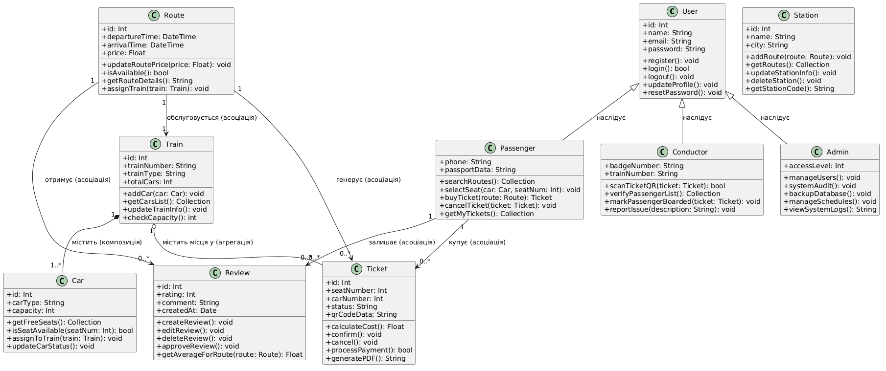

# Електронна система продажу залізничних квитків

## 1. Загальна характеристика предметної галузі
Проєкт є веб-додатком на базі фреймворку **Laravel (MVC)**, створеним для автоматизації процесів пошуку, бронювання та придбання залізничних квитків онлайн, а також для зручного управління розкладом руху потягів і схемою вільних місць.

Система підтримує трьох типів користувачів:
- **Пасажир** (пошук маршрутів, вибір вагонів і місць, бронювання, оплата, скасування квитків).
- **Провідник** (перевірка дійсності електронних квитків та зчитування QR-кодів при посадці).
- **Адміністратор** (управління маршрутами, потягами, розкладом руху, цінами та користувачами).

## 2. Основний Use Case (Повна форма)
- **Назва:** Купити залізничний квиток
- **Головний актор:** Пасажир
- **Короткий опис:** Пасажир вводить станцію відправлення та призначення, обирає дату, потяг, вагон і конкретне вільне місце на схемі, заповнює паспортні дані пасажирів, здійснює онлайн-оплату, після чого система генерує електронний проїзний документ із QR-кодом і фіксує бронювання в базі даних.

## 3. UML-діаграми

### Діаграма варіантів використання (Use Case Diagram)

### Діаграма класів (Class Diagram)

